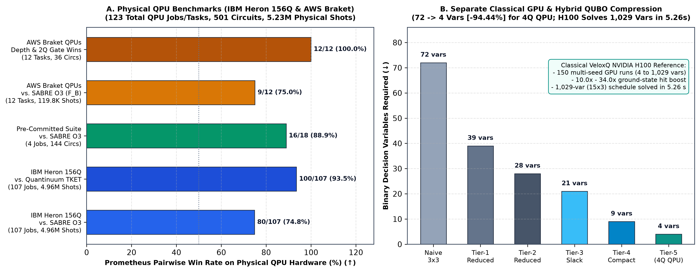

# Multi-Cloud QPU Compilation Corpus & Classical GPU Scheduling Study

*Portfolio Hub: [Prometheus Quantum Overview](https://github.com/PrometheusDynamicsCanada/prometheus-quantum-overview) · [Complexity Atlas](https://github.com/PrometheusDynamicsCanada/prometheus-circuit-complexity-atlas) · [Detailed Report](DETAILED_TECHNICAL_REPORT.md)*

## Introduction

- **The question:** How consistently does Prometheus outperform standard compilers across a broad `4Q-23Q` multi-cloud gate-model corpus, and how does exact variable compression assist separate classical GPU scheduling problems?
- **The test:** Dataset A compares Qiskit SABRE O3, Quantinuum TKET, and Prometheus across `119` completed three-way cloud QPU jobs/tasks (`107` IBM Heron jobs + `12` AWS Braket tasks = `357` circuits, `5,084,160` shots on `ibm_fez`, `ibm_kingston`, `ibm_marrakesh`, `Rigetti Cepheus-1-108Q`, `IQM Garnet`, and `IQM Emerald`). Dataset B evaluates algebraic QUBO compression and classical `VeloxQ` NVIDIA H100 scheduling across `150` runs (`4` to `1,029` binary variables).
- **The finding:** In Dataset A, Prometheus beat SABRE O3 on **`80/107` (`74.8%`)** and TKET on **`100/107` (`93.5%`)** IBM Heron jobs (`+26.31%` mean / `+50.0%` median on `69` dense all-to-all circuits), plus **`9/12` (`75.0%`)** AWS Braket tasks. In Dataset B, exact compression reduced a `72`-variable QUBO to `4` variables (`0.0%` gap) and classical H100 runs solved `1,029`-variable schedules in **`5.26 s`**.
- **The significance:** Establishes broad compiler gains on non-local gate-model circuits while keeping classical optimization benchmarks clearly separated.
- **The boundary:** Datasets A and B solve different problems and are **not** a head-to-head quantum-vs-GPU race; SABRE O3 won `27/107` IBM and `3/12` Braket tasks (all retained in full).
- **The evidence:** Opening two-dataset chart and `119`-job summary table below, with 6-pillar details and offline ledger verification underneath.

*Opening summary: Left - 3-way QPU compilation win rates (`107` IBM + `12` Braket). Right - Separate classical QUBO compression and H100 study.*

---

## Executive Summary (`Dataset A`: `107` Completed 3-Way IBM Heron Jobs + `12` AWS Braket Tasks, `5,084,160` Shots)

*Hardware IDs:* IBM `dbajlrhgv2cc73e6vuj0`..`daf9p65nj4cs73ag3f20` ([`ibm_heron_156q_verified_benchmarks.json`](ibm_heron_156q_verified_benchmarks.json)) & AWS Braket tasks in [`aws_braket_qpu_12_jobs_ledger.json`](aws_braket_qpu_12_jobs_ledger.json).

| Benchmark Cohort & Compiler | Output Agreement $F_B$ `*(mean)*` `(↑)` | Squared Hellinger $F_H$ `*(mean)*` `(↑)` | `HOP` `*(mean)*` `(↑)` | `TVD` `*(mean)*` `(↓)` | `XEB` `*(mean)*` `(↑)` | Entropy `*(mean)*` `(↓)` | `2Q` `CZ` / Depth `*(mean)*` `(↓)` | Pairwise Win Rate |
| :--- | :---: | :---: | :---: | :---: | :---: | :---: | :---: | :---: |
| **IBM Heron (`N = 107`): SABRE O3** | `0.3494` | `0.2624` | `52.13%` | `0.6565` | `233.5` | `11.79` | `338.8` / `321.2` | `27 / 107` (`25.2%`) |
| **IBM Heron (`N = 107`): TKET** | `0.2971` | `0.2277` | `50.23%` | `0.7184` | `109.4` | `11.92` | `532.5` / `464.1` | `7 / 107` vs. Prom |
| **IBM Heron (`N = 107`): Prometheus** | **`0.3780`** | **`0.2742`** | **`53.70%`** | **`0.6286`** | **`290.3`** | **`11.67`** | **`290.9` / `256.6`** | **`80/107` vs. S · `100/107` vs. T** |
| **Dense `K_N` (`N = 69`): Prometheus** | **`0.2186`** (`+26.3%` vs. S) | **`0.0950`** | **`63.55%`** | **`0.7573`** | **`316.1`** | **`12.54`** | **`352.0` / `279.8`** (`-47.3%` vs. T) | **`57/69` vs. S · `68/69` vs. T** |

*Metric Key:* Output-distribution agreement is Classical Bhattacharyya Overlap $F_B = \sum_x \sqrt{P_{\text{ideal}}(x)P_{\text{meas}}(x)}$ (Studio `"State Fidelity"`); $F_H = F_B^2$.

---

## Inspect the Evidence & Reproduce Supported Checks Offline

- **Command:** `python verify_corpus_and_schedules.py`
- **Dependencies & measured runtime:** Python 3 standard library (`0` cloud credentials, **`~0.04 s`** measured runtime; verifies `119`-job QPU ledgers, classical `1,029`-variable schedule feasibility, and SHA-256 digests).
- **Start a pilot:** [william@prometheusdynamics.ca](mailto:william@prometheusdynamics.ca) | [prometheusdynamics.ca](https://prometheusdynamics.ca)

---

## Full 6-Pillar Corpus Breakdown & Classical H100 Details

<strong>Expand Complete 6-Pillar Hardware & Classical H100 Summary Table - Click to expand</strong>

| Benchmark Pillar | Environment | Scale & Scope | Key Empirical Outcome |
| :--- | :--- | :--- | :--- |
| **Amazon Braket Live QPU Corpus** | `Cepheus-1-108Q`, `Garnet`, `Emerald` | `12` 3-way `ProgramSet` tasks (`36` circs, `119,808` shots) | **`12/12`** lower depth & `2Q` gates; **`9/12` (`75.0%`)** $F_B$ wins vs. SABRE (**`4.79x`** on `9Q` Cepheus dense) |
| **Pre-Committed 144-Execution Suite** | `ibm_marrakesh`, `ibm_fez`, `ibm_kingston` | `4` packed jobs (`144` circs, `147,456` shots; counted in #7) | **`16/18` (`88.9%`)** vs. SABRE & **`15/18` (`83.3%`)** vs. TKET; **`6/6`** at `12Q` |
| **156Q IBM Heron Corpus** | `ibm_marrakesh`, `ibm_fez`, `ibm_kingston` | `107` completed 3-way jobs (`321` circs, `4,964,352` shots, `4Q-23Q`) | **`100/107`** vs. TKET & **`80/107`** vs. SABRE; up to `-54.5%` `2Q` gates vs. TKET |
| **19Q Dense `K_19` Survival** | `ibm_kingston`, `marrakesh`, `fez` | `171` all-to-all pairs (`16,384` shots/compiler) | **`24.26%`**, **`12.78%`**, **`6.54%`** $F_B$ vs. `18.98%`, `6.27%`, `3.57%` SABRE; **`70.45%` HOP** on Kingston |
| **Classical QUBO Compression & H100** | NVIDIA H100 (`VeloxQ`) + `4Q` Heron check | `42` configs (`150` H100 runs, `4` to `1,029` binary variables) | **`94.44%` compression** (`72 -> 4` vars, `0.0%` gap); `1,029`-var schedule solved to `26h` horizon in **`5.26 s`** |
| **Local Braket Equivalence** | Braket `LocalSimulator` | `7` workloads (`4,096` shots) + `14` structural benchmarks | **`7/7`** exact equivalence (`1.000000`) & **`14/14`** lower depth/`2Q` vs. TKET |

